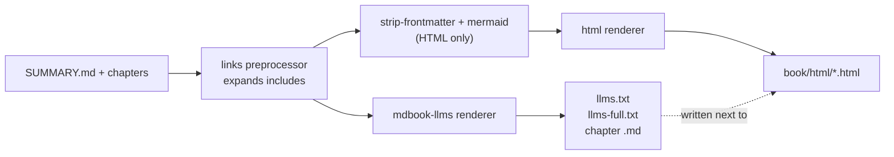

# Getting started

mdbook-llms is an [mdBook](https://rust-lang.github.io/mdBook/) 0.5 renderer that follows the [llms.txt](https://llmstxt.org/) convention. Alongside your HTML site it writes:

- [`llms.txt`](llms.txt): an index of every chapter, grouped by SUMMARY.md parts
- [`llms-full.txt`](llms-full.txt): every chapter in reading order, in one file
- `<chapter>.md`: each chapter's Markdown at the path its HTML would use

## How it fits into mdBook



The llms renderer reads the book before the HTML-only preprocessors run, so it sees chapter frontmatter and keeps Mermaid blocks as plain fenced code.

## Quick start

Install the binaries:

```sh
cargo install --locked --git https://github.com/ttdonovan/mdbook-llms
```

Add the renderer and the frontmatter preprocessor to your `book.toml`:

```toml
[preprocessor.strip-frontmatter]

[output.html]

[output.llms]
```

Run `mdbook build`. The llms files appear in `book/html/`, next to the site.

This book is built the same way. See [Usage](usage.md) for every option and [Contributing](contributing.md) to work on the crate.
